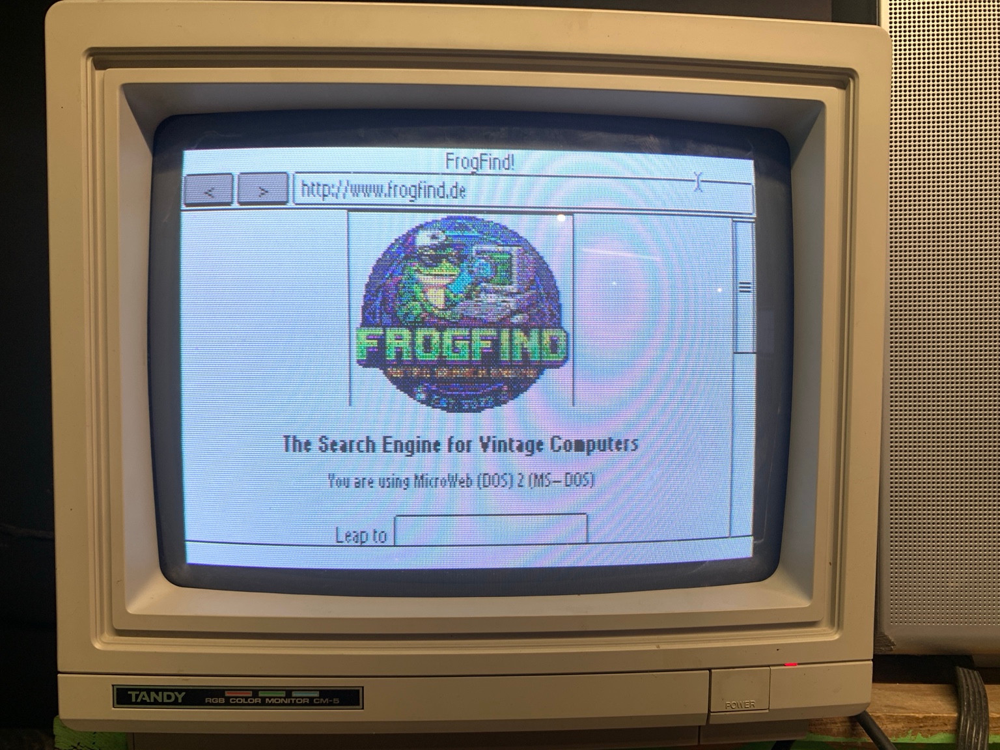

# MicroWeb DOS web browser
MicroWeb is a web browser for DOS that runs as a 16-bit real mode application and is designed to run on minimal hardware.



*FrogFind.de on real Tandy hardware, in 16 colours.*

## Minimum requirements
To run you will need:
* Intel 8088 or compatible CPU
* CGA, EGA, VGA, Hercules or Tandy 1000 compatible graphics
* A network interface (it is possible to use your machine's serial port with the EtherSLIP driver)
* A mouse is desirable but not 100% required
* 640K RAM is desirable but can run with less
* Extra memory via XMS or EMS can be used if available and is recommended for loading heavier web pages and images

## CPU compatibility
The standard build preserves 8086/8088 support. An 8088-safe runtime CPU probe
selects an NEC V20/V30 immediate-shift path for JPEG IDCT columns; other CPUs
use the standard path. No separate V20 build is needed.

The probe and IDCT results have been checked with MartyPC's Intel 8088 and NEC
V20 CPU models. Model-only IDCT timings show a small improvement, but whole-image
speed on a V20 and operation on physical V20/V30 hardware remain unverified.

## Limitations
* Direct HTTP only; optional plaintext HTTPS gateway (see HTTPS limitations below)
* GIF, baseline JPEG and non-interlaced PNG images are rendered. PNG supports palette and grayscale (1/2/4/8-bit), RGB, grayscale-alpha and RGBA (8-bit), all five row filters, and transparency.
* Partial PNG alpha uses ordered coverage in color modes; monochrome composites against the page background. Adam7 and 16-bit PNG pixels are unsupported, while their dimensions are still loaded for layout.
* PNG rows are limited to 4096 bytes before filtering, and rendered images to 1024 pixels wide by 4096 high, subject to available RAM. A bounded workspace of about 40K is shared with the other image decoders. The local `examples/png.htm` sample needs its accompanying PNG files and `tandy.gif`.
* No CSS or Javascript
* Large or complex pages may be truncated if there is not enough RAM available
* Mouse cursor is currently not visible in Hercules mode

## Forms and HTTP
GET and POST forms preserve hidden fields, selected option values and the clicked
submit button, with URL encoding and bounded submission buffers. Oversized forms
are rejected rather than truncated; POST bodies are limited to 511 encoded bytes.
Reset buttons are displayed but do not reset fields; disabled fieldset/optgroup
inheritance is not implemented.
Redirects are limited to five hops, with POST-aware 301/302/303/307/308 handling.
Stalled plain GET requests may retry once before receiving response bytes; POST
requests are never automatically retried. Native TLS remains unsupported.
`HTTP_USER_AGENT` adds an optional suffix (up to 120 bytes); invalid header
characters or longer values are ignored. URL and HTML-attribute handling keeps
query data intact and rejects oversized URLs.

GIF decoding uses a faster streaming LZW path without increasing decoder RAM.

## Mouse wheel
Mouse wheels scroll three text lines per notch when the installed DOS mouse
driver supports CuteMouse WheelAPI 1.0. Older mouse drivers continue to work
without wheel scrolling. In DOSBox-X, disable wheel-to-key mapping with
`mouse_wheel_key=0` to use its native wheel API.

## Keyboard shortcuts
| Key				           | Shortcut                                                                    |
|-------------------|-----------------------------------------------------------------------------|
| Escape            | Exit                                                                        |
| F2                | Invert screen colours in monochrome modes (useful for old LCD displays)     |
| F3                | Toggle title bar / status bar visibility                                    |
| F5                | Reload page                                                                 |
| F6 / Ctrl+L       | Focus address bar                                                           |
| Tab / Shift+Tab   | Cycle through selectable page elements                                      |
| Enter             | Follow link / press button                                                  |
| Cursor up/down    | Scroll page                                                                 |
| Page up/down      | Scroll page in large increments                                             |
| Home              | Jump to start of page                                                       |
| End               | Jump to end of page                                                         |

## Supported video modes
MicroWeb supports a wide range of different video modes. You will be asked on startup to select a mode and one will be suggested based on your detected hardware.
* 640x200 monochrome (CGA)				
* 640x200 inverse monochrome (Palmtop CGA)
* 320x200 4 colours (CGA)
* 320x200 16 colours (Composite CGA)
* 640x200 16 colours (EGA)		
* 640x350 monochrome (EGA)				
* 640x350 16 colours (EGA)				
* 640x480 monochrome (VGA)				
* 640x480 16 colours (VGA)				
* 320x200 256 colours (VGA)				
* 720x348 monochrome (Hercules)		
* 640x400 monochrome (Olivetti M24)
* 640x400 monochrome (Toshiba T3100)
* 240x128 monochrome (HP 95LX)
* 640x200 16 colours (Amstrad PC1512)
* 320x200 16 colours (Tandy 1000, native RGBI)
* 640x200 16 colours (Tandy Video II / TGA-II, experimental)

### Tandy graphics
* **Tandy 1000 EX/HX (640K):** run `TANDY` for native 320x200 RGBI,
  optionally followed by a URL or full local path. Keep `TANDY.BAT`,
  `VRESERVE.COM`, `MICROWEB.EXE`, and the `.dat` files together. The DOS 3+
  launcher protects video RAM with a reservation of about 18K until reboot;
  unsupported or occupied memory layouts are rejected. Try `examples/tandy.htm`.
* **Tandy Video II / TGA-II:** use `MICROWEB -video=u` from 80-column colour
  text mode for 640x200 RGBI. This mode is experimental: host regression tests
  pass, but it has not been validated on real SL/TL/RL hardware or a Video II
  emulator. It requires detected Video II hardware and a safely reservable
  64K video-memory aperture; otherwise use a standard CGA mode.

## Command line options
You can use a URL as an argument to load a specific page on startup. This can also be a path to a local html file. 

| Option    | Effect
|-----------|-------
| -invert   | Start monochrome modes with inverted screen colours (useful for some LCD monitors)
| -noems    | Disable EMS memory usage
| -noxms    | Disable XMS memory usage
| -noimages | Disables image decoders - useful for very low memory setups
| -useswap  | Experimental disk swapping mode to increase available memory
| -video=#  | Skip the video mode selection menu and choose a mode ahead of time, e.g. -video=a
 
For example `MICROWEB -noems http://68k.news` will load the 68k.news website on startup but disable the EMS routines

## HTTPS limitations
MicroWeb has no native TLS. Direct connections support HTTP only; HTTPS addresses
are kept intact rather than silently changed to HTTP.

* **HTTPS gateway:** set `MICROWEB_HTTPS_PROXY=192.168.0.50:8080` to use a trusted
  plaintext TLS gateway such as [Crypto Ancienne / carl](https://github.com/classilla/cryanc).
  The setting accepts a DNS name or IPv4 address and optional port (default 80),
  without a scheme, credentials or path. MicroWeb sends absolute HTTPS URLs to
  the gateway; this is not a CONNECT tunnel or a conventional TLS proxy.
* **HTTP proxy:** `HTTP_PROXY=192.168.0.50:8000` applies only to HTTP destinations.
  It does not enable HTTPS forwarding.
* **Reader:** no public reader is configured by default. To offer a manually
  followed link on the HTTPS-help page, set `MICROWEB_READER` to a trusted
  plain-HTTP prefix ending in its empty destination query parameter, for example
  `http://192.168.0.50/read.php?a=`. The complete destination is URL-encoded;
  links exceeding 511 bytes are refused. Verify the reader's endpoint and HTTP
  support yourself; no unverified FrogFind replacement is selected automatically.

**The DOS-to-gateway/reader connection is unencrypted.** These services see the
URLs and any submitted content. Use a trusted local network and avoid passwords,
private links and tokens. The gateway handles upstream TLS and certificates;
MicroWeb cannot verify them. Gateway browsing carries an unencrypted-link status
warning and adds no client TLS buffer. It does not make modern scripts or styles
compatible with MicroWeb.

Without a configured gateway, HTTPS opens the local help page. Gateway errors
never fall back to direct HTTP, HTTPS-to-HTTP redirects are rejected, and
scheme-relative redirects preserve HTTPS. Clear either setting with
`SET MICROWEB_HTTPS_PROXY=` or `SET MICROWEB_READER=`.

## Getting started
Keep the `.dat` assets beside `MICROWEB.EXE`. Launching it from another directory
or through `PATH` preserves that directory for relative page paths. Normal exit
and initialization failures restore the DOS network and interrupt state.

Check out the [releases page](https://github.com/jhhoward/MicroWeb/releases) which will include a pre-built binary. Also available are FreeDOS boot disk images for 360K and 720K floppies, which are configured to work with a NE2000 network adapter. These boot images can be used in an emulator such as [PCem](https://pcem-emulator.co.uk/).

## Network setup
MicroWeb uses Michael Brutman's [mTCP networking library](http://www.brutmanlabs.org/mTCP/) for the network stack. You will need a DOS packet driver relevant to your network interface. You can read more about configuring DOS networking [here](http://brutmanlabs.org/Dos_Networking/dos_networking.html)

## Build instructions
To build you will need the [OpenWatcom 1.9 C++ compiler](https://sourceforge.net/projects/openwatcom/files/open-watcom-1.9/). 
On Windows, use OpenWatcom's wmake to build the makefile in the project/DOS folder.

On Linux, install the Linux-hosted [Open Watcom v2 tools](https://github.com/open-watcom/open-watcom-v2/releases), then run from the repository root:

```sh
WATCOM=/path/to/watcom tools/build-dos.sh
```

This requires a native C++ compiler for the mTCP runtime patcher. The executable, `VRESERVE.COM`, and `TANDY.BAT` are written to `build/dos`; pass an optional output directory to the script to use a different location. The Linux build uses the same large memory model, DOS overlays, and `-0` (8086/8088) instruction target as the Windows build. Copy the executable and the repository's `.dat` files together when running it.

